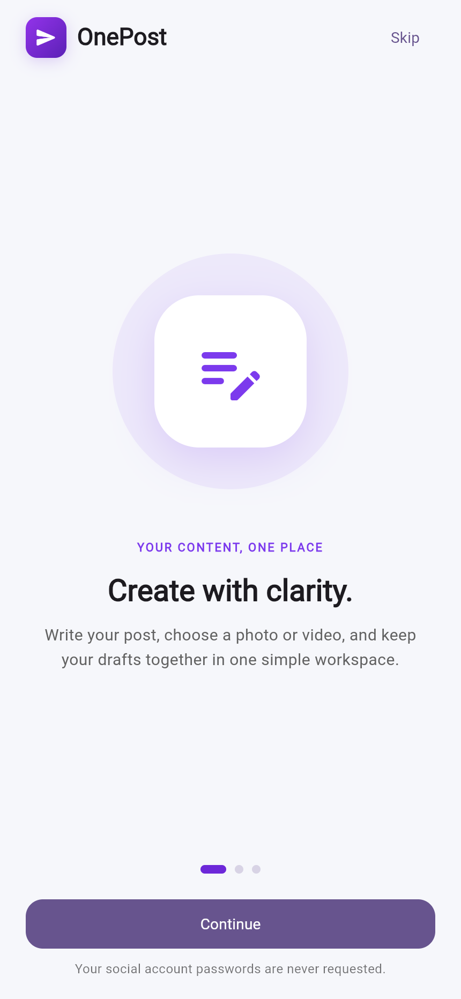
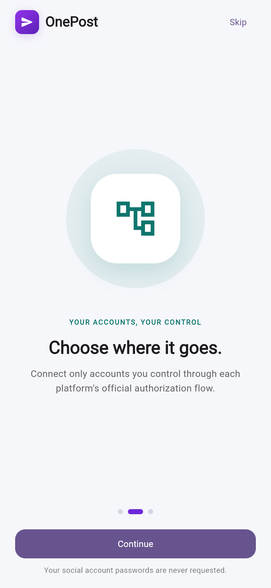
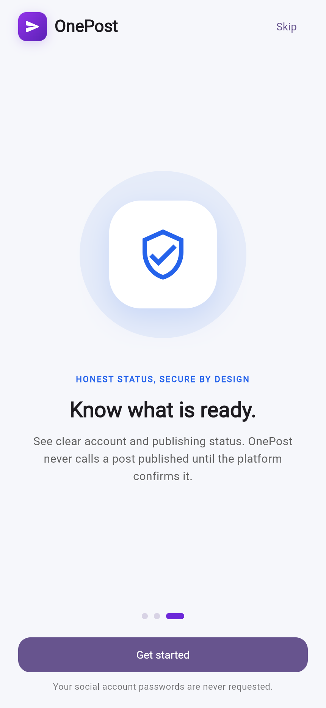
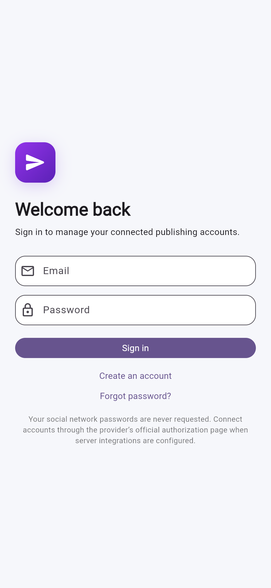
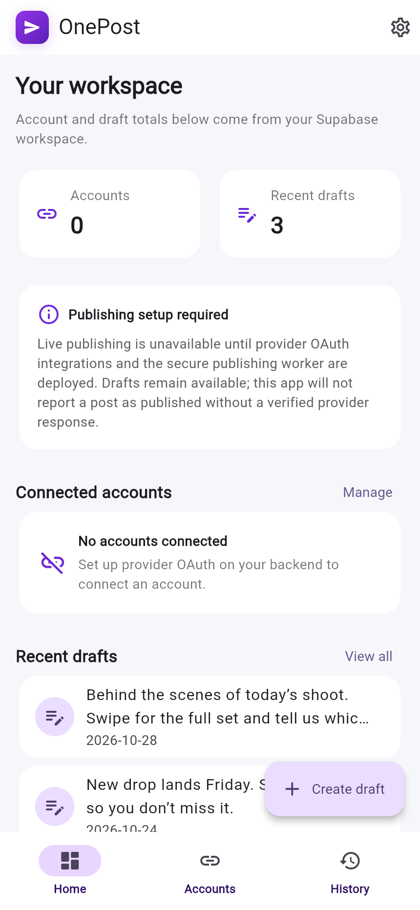
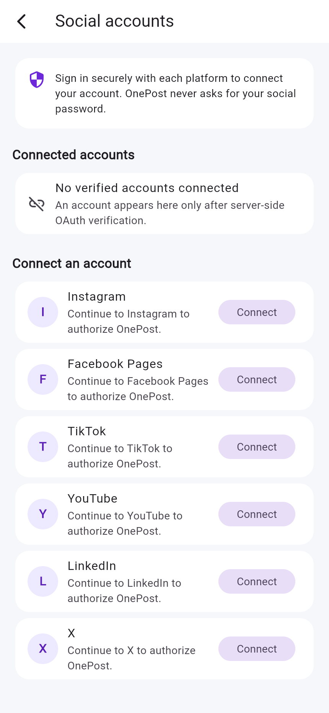
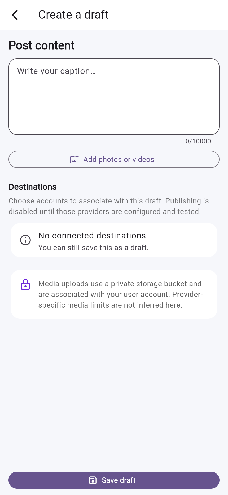
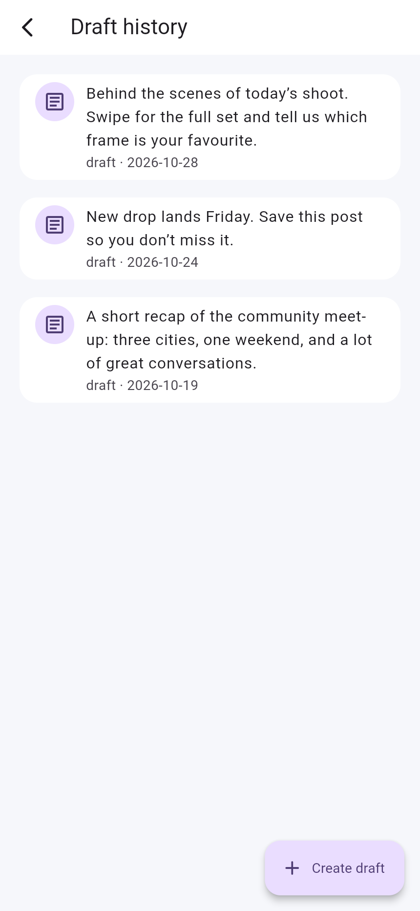

<div align="center">


# OnePost

**One workspace for drafting social posts across six platforms — built with Flutter and Supabase.**

[](https://flutter.dev)
[](https://dart.dev)
[](https://supabase.com)
[](#license)

[Overview](#overview) · [Screenshots](#screenshots) · [Status](#project-status) · [Architecture](#architecture) · [Getting started](#getting-started) · [Documentation](#documentation)

</div>

---

## Overview

OnePost is a Flutter Android/iOS client foundation for social publishing. It brings post drafting, private media handling, and account management into a single mobile workspace, backed by Supabase Auth, PostgreSQL Row Level Security (RLS), and private Storage.

The app is deliberately honest about what it can do: a post is **never** labelled as published without a verified response from the target platform. Provider integrations are not shipped yet, so the publishing path remains disabled while drafting, authentication, and media storage work end to end.

### Highlights

- Email/password sign-up, sign-in, and password-reset requests through Supabase Auth.
- Supabase sessions and PKCE verifiers stored with platform secure storage.
- Owner-scoped accounts, drafts, and media enforced by database RLS.
- Draft creation through a single transactional, security-definer database function.
- Private image/video uploads with MIME signature checks, size limits, and streaming SHA-256 checksums.
- Material 3 theming, Riverpod state management, GoRouter navigation, and onboarding.
- Android/iOS launcher branding generated from the OnePost mark.

---

## Screenshots

Captured from the real OnePost widget tree at a 430 × 932 mobile viewport. The gallery uses static draft data for layout preview; no social account is simulated, and the account screens deliberately show their real empty state.

<table>
  <tr>
    <td align="center"><br /><sub><b>Onboarding · Create</b></sub></td>
    <td align="center"><br /><sub><b>Onboarding · Accounts</b></sub></td>
    <td align="center"><br /><sub><b>Onboarding · Status</b></sub></td>
  </tr>
  <tr>
    <td align="center"><br /><sub><b>Sign in</b></sub></td>
    <td align="center"><br /><sub><b>Dashboard</b></sub></td>
    <td align="center"><br /><sub><b>Social accounts</b></sub></td>
  </tr>
  <tr>
    <td align="center"><br /><sub><b>Composer</b></sub></td>
    <td align="center"><br /><sub><b>Draft history</b></sub></td>
    <td align="center"><br /><sub><b>Brand mark</b></sub></td>
  </tr>
</table>

---

## Project status

> **Development preview — not production-release ready.**
> OAuth connection code is implemented but requires deployment and provider app credentials. Live social publishing is **not implemented**. Use the generated APK for UI and development testing only.

| Capability | Status | Notes |
| --- | :---: | --- |
| Email/password auth | ✅ Implemented | Supabase Auth with PKCE and secure local session storage |
| Password reset request | ✅ Implemented | Requires a configured SMTP provider for reliable delivery |
| Onboarding flow | ✅ Implemented | Completion stored locally with `shared_preferences` |
| Dashboard totals | ✅ Implemented | Read from the signed-in user's Supabase records |
| Draft composer | ✅ Implemented | Caption + up to 10 media files + destination selection |
| Draft history | ✅ Implemented | Owner-scoped list from `posts` |
| Private media upload | ✅ Implemented | Signature, size, and checksum validation; private bucket |
| Social account list | ✅ Implemented | Reads verified accounts; empty by default |
| Provider OAuth start | 🚧 Implemented, not deployed | Authenticated start function for six providers; requires app credentials |
| OAuth callback + encrypted token storage | 🚧 Implemented, not deployed | Provider callback, account discovery, AES-GCM token encryption |
| Publishing adapters | ❌ Not implemented | Instagram, Facebook Pages, TikTok, YouTube, LinkedIn, X |
| Durable publishing worker | ❌ Not implemented | Queue, leases, retries, reconciliation, monitoring |
| Live publish verification | ❌ Not implemented | No post is marked published without provider confirmation |

There are no sample account records or fake publish-success paths in the codebase.

---

## Tech stack

| Layer | Choice |
| --- | --- |
| UI | Flutter 3.47 (Material 3), Dart 3.13 |
| State | `flutter_riverpod` |
| Navigation | `go_router` with auth-aware redirects |
| Backend | Supabase Auth, PostgreSQL (RLS), private Storage |
| Models | `freezed` + `json_serializable` |
| Networking | `dio`, `supabase_flutter` |
| Security | `flutter_secure_storage`, PKCE, checksums, MIME sniffing |
| Media | `image_picker`, `url_launcher`, `crypto`, `uuid` |
| Local state | `shared_preferences` (onboarding only) |

---

## Architecture

```text
┌────────────────────────────────────────────────────────────────┐
│                        Flutter client                          │
│                                                                │
│  app/          theme · router · app shell                      │
│  features/     authentication · dashboard · composer           │
│                social_accounts · publishing                    │
│  core/         config · errors · security · shared widgets     │
└───────────────┬───────────────────────────────┬────────────────┘
                │ Supabase SDK (HTTPS)          │ oauth-start (HTTPS)
                ▼                               ▼
┌───────────────────────────────┐   ┌────────────────────────────┐
│           Supabase            │   │   Server-side integrations │
│                               │   │   (not in this repo)       │
│  Auth (PKCE, sessions)        │   │   OAuth start / callback   │
│  Postgres + RLS               │   │   Token encryption / KMS   │
│  Storage (private bucket)     │   │   Publishing worker        │
│  RPC: create_post_draft       │   │   Status polling / webhooks│
└───────────────────────────────┘   └────────────────────────────┘
```

### Client flow

1. **Onboarding** → **Sign in** (Supabase Auth).
2. The router redirects unauthenticated users to `/sign-in` and preserves an internal `next` destination.
3. The **dashboard** loads account and draft totals for the current user.
4. The **composer** collects a caption, media, and optional destinations.
5. `create_post_draft` validates ownership and inserts the post and destinations in one transaction.
6. Media is uploaded to `onepost-media/<user-id>/<random-path>` and recorded in `media_assets`.
7. **History** lists the user's drafts. Publishing stays disabled until server adapters exist.

### Data model

| Table | Purpose |
| --- | --- |
| `profiles` | One row per auth user, created by trigger |
| `social_accounts` | Verified provider accounts (no client writes) |
| `oauth_credentials` | Server-only token ciphertext placeholders; no client grants |
| `posts` | Drafts and publishing status (`draft`, `queued`, …) |
| `post_destinations` | Per-account destination state and provider result |
| `publishing_batches` | Idempotent batch of destinations for a post |
| `publishing_jobs` | Worker jobs with leases and retry metadata |
| `media_assets` | Private storage metadata and checksums |
| `provider_webhook_events` | Deduplicated provider webhook receipts |
| `audit_events` | User-scoped audit trail |
| `oauth_authorization_states` | Server-only OAuth state/PKCE storage |

All tables have RLS enabled. Credential, OAuth-state, webhook, and job tables have no client grants.

---

## Project structure

```text
├── lib/
│   ├── main.dart                     # Bootstraps Supabase + app
│   ├── app/
│   │   ├── app.dart                  # MaterialApp / configuration gate
│   │   ├── router.dart               # Auth-aware GoRouter
│   │   └── theme.dart                # Material 3 theme
│   ├── core/
│   │   ├── config/app_config.dart    # Compile-time Supabase config
│   │   ├── errors/app_error.dart
│   │   ├── security/                 # Secure auth storage
│   │   └── widgets/                  # Brand mark, config screen
│   └── features/
│       ├── authentication/           # Onboarding + auth screens
│       ├── dashboard/                # Dashboard, history, settings
│       ├── composer/                 # Draft composer + media repo
│       ├── publishing/               # Post repository + models
│       └── social_accounts/          # Accounts + OAuth start client
├── backend/
│   ├── supabase/
│   │   ├── migrations/               # Schema, RLS, OAuth RPC, storage bucket
│   │   └── functions/                # OAuth start/callback Edge Functions
│   └── worker/README.md              # Publishing worker status
├── docs/                             # Architecture, security, testing, …
│   └── screenshots/                  # README gallery
├── assets/brand/                     # Launcher/brand mark
├── test/                             # Unit + widget tests
├── tool/screenshot_app/              # Dev-only screenshot harness
├── android/ · ios/ · web/            # Platform projects
└── pubspec.yaml
```

---

## Getting started

### Prerequisites

- Flutter 3.47+ and Dart 3.13+
- A Supabase project (free tier is sufficient for development)
- Android Studio / Xcode toolchains for device builds

Verify your environment:

```bash
flutter doctor
flutter --version
```

### 1. Clone and install

```bash
git clone https://github.com/mzainulabideendev/One_Post.git
cd One_Post
flutter pub get
```

### 2. Configure Supabase

1. Create a project at [supabase.com](https://supabase.com).
2. Open **SQL Editor** and run [`backend/supabase/migrations/001_init.sql`](backend/supabase/migrations/001_init.sql), followed by [`backend/supabase/migrations/002_oauth_connections.sql`](backend/supabase/migrations/002_oauth_connections.sql), or apply both with the Supabase CLI.
3. In **Authentication → Providers**, enable Email.
4. For production email delivery, configure a custom SMTP provider. The default project email ceiling is very low.
5. Configure provider apps, exact callback URLs, and server-only secrets as described in [`docs/oauth-deployment.md`](docs/oauth-deployment.md).

### 3. Add local configuration

```bash
cp .env.example .env
```

Edit `.env` with your project URL and **publishable/anon** key:

```json
{
  "SUPABASE_URL": "https://YOUR_PROJECT_ID.supabase.co",
  "SUPABASE_PUBLISHABLE_KEY": "YOUR_SUPABASE_PUBLISHABLE_OR_ANON_KEY"
}
```

> **Never** put a Supabase `service_role` key, provider client secret, access token, or encryption key in the app. The client validates that it received a public key and refuses to start otherwise.

### 4. Run

```bash
flutter pub get
flutter run --dart-define-from-file=.env
```

The app shows a configuration screen instead of the sign-in flow when the Supabase URL or public key is missing/invalid. Apply the OAuth migration and deploy both Edge Functions before expecting a live provider connection.

---

## Building

### Android — debug APK

```bash
flutter build apk --debug --dart-define-from-file=.env
```

The APK is written to `build/app/outputs/flutter-apk/app-debug.apk`.

### Android — release APK

Release builds require an owner-controlled keystore and fail instead of falling back to the shared debug key.

| Variable | Purpose |
| --- | --- |
| `ONEPOST_KEYSTORE_PATH` | Absolute path to the `.jks` keystore |
| `ONEPOST_KEYSTORE_PASSWORD` | Keystore password |
| `ONEPOST_KEY_ALIAS` | Signing key alias |
| `ONEPOST_KEY_PASSWORD` | Signing key password |

```powershell
$env:ONEPOST_KEYSTORE_PATH="C:\keys\onepost-release.jks"
$env:ONEPOST_KEYSTORE_PASSWORD="..."
$env:ONEPOST_KEY_ALIAS="onepost"
$env:ONEPOST_KEY_PASSWORD="..."

flutter build apk --release --dart-define-from-file=.env
```

Keep the keystore and passwords outside source control. Confirm the package identifier (`com.onepost.mobile` is a placeholder) before distributing.

### iOS

```bash
flutter build ios --release --dart-define-from-file=.env
```

Requires macOS, Xcode, and your Apple provisioning credentials.

### Web (development preview)

```bash
flutter build web --dart-define-from-file=.env
```

The mobile app is the primary target; the web build is useful for quick UI review and the screenshot harness.

---

## Testing

```bash
flutter analyze
flutter test
```

Current verification in this workspace:

- `flutter analyze` — **No issues found**
- `flutter test` — **16 tests passed**

Coverage includes:

- Auth error mapping (rate limits, invalid credentials).
- Media signature and size policy.
- Freezed model round-trips and provider capabilities.
- Provider OAuth URL/host validation.
- Router redirect safety (internal `next` only).
- Unconfigured-backend configuration screen.
- Onboarding advance/complete behavior.

These checks validate the client only. They do **not** prove Supabase deployment, cross-user RLS isolation, storage policies against a real project, or provider publishing. See [`docs/testing.md`](docs/testing.md) for the remaining integration plan.

---

## Regenerating the screenshots

The gallery is produced from the real widgets using a development-only entry point, not mockups:

```bash
flutter build web -t tool/screenshot_app/main.dart
```

Serve `build/web` locally, then capture the routes with a browser automation tool. The harness:

- uses the production theme, screens, and layout;
- replaces the two Supabase-backed list providers with static draft data;
- skips the auth redirect so each route can be opened directly (`?screen=dashboard`);
- deliberately fabricates **no** connected social accounts.

It is excluded from production entry points and is not shipped in the app. See [`tool/screenshot_app/main.dart`](tool/screenshot_app/main.dart).

---

## Security model

- Only an HTTPS Supabase URL and a publishable/anon key are accepted; service-role JWTs are rejected.
- Sessions and PKCE verifiers live in `flutter_secure_storage`.
- RLS restricts profiles, accounts, posts, destinations, media metadata, and audit events to the authenticated owner.
- Uploads use a private bucket, an owner-prefixed random path, a 100 MB cap, allowed MIME types, file-signature checks, and a streaming SHA-256 checksum.
- `create_post_draft` is a `security definer` function that validates authentication, caption length, duplicate destinations, destination limits, and account ownership before inserting.
- Provider secrets never reach the client. OAuth exchanges and token encryption belong on the server.
- No HTTP acceptance response is treated as a successful publish.

Read [`docs/security.md`](docs/security.md) before deploying.

---

## Roadmap

- [ ] Apply the OAuth RPC migration, configure provider secrets, and deploy the OAuth Edge Functions.
- [ ] Add KMS-backed token encryption and refresh handling (server only).
- [ ] Implement provider adapters for Instagram, Facebook Pages, TikTok, YouTube, LinkedIn, and X.
- [ ] Build the durable publishing worker with leases, retries, backoff, and reconciliation.
- [ ] Verify every provider with authorized staging accounts and documented success conditions.
- [ ] Add Supabase RLS/storage cross-user integration tests.
- [ ] Implement provider token refresh, revocation, and encryption-key rotation.
- [ ] Configure custom SMTP and production auth redirects.
- [ ] Replace the placeholder Android package identifier and configure release signing.
- [ ] Add CI (analyze, test, build) and dependency/security scanning.

---

## Documentation

| Document | Contents |
| --- | --- |
| [`docs/architecture.md`](docs/architecture.md) | Implemented layers and design rules |
| [`docs/provider-setup.md`](docs/provider-setup.md) | Per-provider release prerequisites |
| [`docs/oauth-deployment.md`](docs/oauth-deployment.md) | OAuth secrets, migrations, deployment and verification |
| [`docs/security.md`](docs/security.md) | Security and compliance notes |
| [`docs/testing.md`](docs/testing.md) | Test coverage and integration gaps |
| [`docs/deployment.md`](docs/deployment.md) | Deployment checklist |
| [`docs/release-readiness.md`](docs/release-readiness.md) | Verified items and release blockers |
| [`backend/supabase/functions/README.md`](backend/supabase/functions/README.md) | Server function status |
| [`backend/worker/README.md`](backend/worker/README.md) | Publishing worker requirements |

---

## Known limitations

- Social provider connection code is implemented but **not deployed/configured**; the six providers require server credentials, registered callbacks, and any required provider approval.
- Access tokens are encrypted at rest by the OAuth callback, but automated token refresh/revocation and key rotation are not implemented.
- The publishing worker and job dispatch do not exist yet, so drafts cannot be published.
- Email sign-up confirmation and password reset depend on Supabase email delivery; configure custom SMTP for production traffic.
- `com.onepost.mobile` is a placeholder application identifier.
- Android release signing and iOS signing require publisher-owned credentials.
- No live authenticated session, cross-user RLS test, or storage isolation test has been performed against a deployed project.

For the full blocker list, see [`docs/release-readiness.md`](docs/release-readiness.md).

---

## License

No license has been declared for this repository yet. Add a `LICENSE` file before distributing or accepting external contributions.

<div align="center">
<sub>Built with Flutter and Supabase.</sub>
</div>
